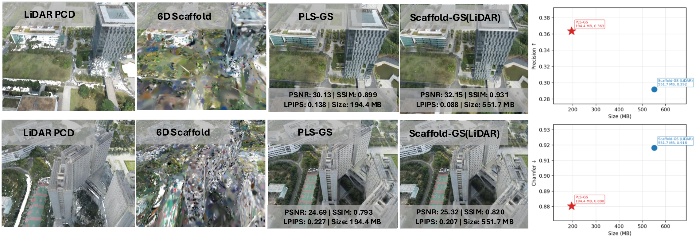

<div align="center">

# PLS-GS: Probabilistic Lidar Scaffolds for Compact, Surface-Aligned Gaussian Splatting

**WACV 2027**

[Krishnan Harikumar](https://github.com/k-harikumar)<sup>1</sup>, Alejandro Fontan<sup>1</sup>, Thierry Peynot<sup>1</sup>, Emili Hernández<sup>2</sup>, Niko Sünderhauf<sup>1</sup>

<sup>1</sup>QUT Centre for Robotics &nbsp;&nbsp; <sup>2</sup>Emesent

[](#)
[](#)

</div>

<p align="center">
  
</p>

## Overview

PLS-GS builds a compact 3D Gaussian Splatting representation from camera images and LiDAR. It fits a Hierarchical Gaussian Mixture Model jointly over position and color to form a continuous, adaptive scaffold, with no voxel grids or octrees. Each rendering Gaussian is anchored to a mixture component and constrained in that component's local surface frame. A Mahalanobis support loss keeps it close to the LiDAR-derived surface. Across five large outdoor scenes, PLS-GS places primitives closer to the measured geometry with substantially fewer primitives, giving a more compact model and faster rendering.

## Code

🚧 **Code release is in preparation and coming soon.** Watch this repository to be notified.

## Citation

```bibtex
@inproceedings{harikumar2027plsgs,
  title     = {{PLS-GS}: Probabilistic Lidar Scaffolds for Compact, Surface-Aligned Gaussian Splatting},
  author    = {Harikumar, Krishnan and Fontan, Alejandro and Peynot, Thierry and Hern{\'a}ndez, Emili and S{\"u}nderhauf, Niko},
  booktitle = {Proceedings of the IEEE/CVF Winter Conference on Applications of Computer Vision (WACV)},
  year      = {2027}
}
```

## Acknowledgements

This work was supported by the Australian Research Council Research Hub in Intelligent Robotic Systems for Real-Time Asset Management (ARIAM) (IH210100030) and Emesent. The authors acknowledge the ongoing support from the Queensland University of Technology (QUT) Centre for Robotics. Our implementation builds on [Scaffold-GS](https://github.com/city-super/Scaffold-GS).
